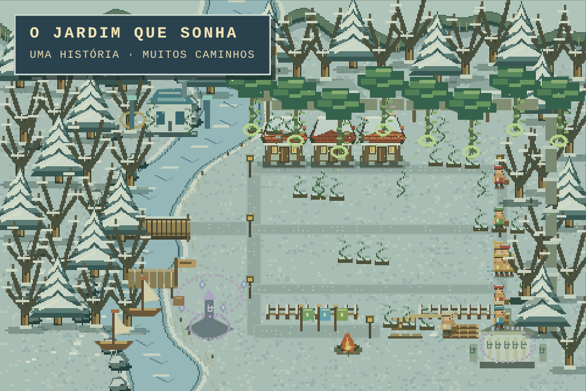
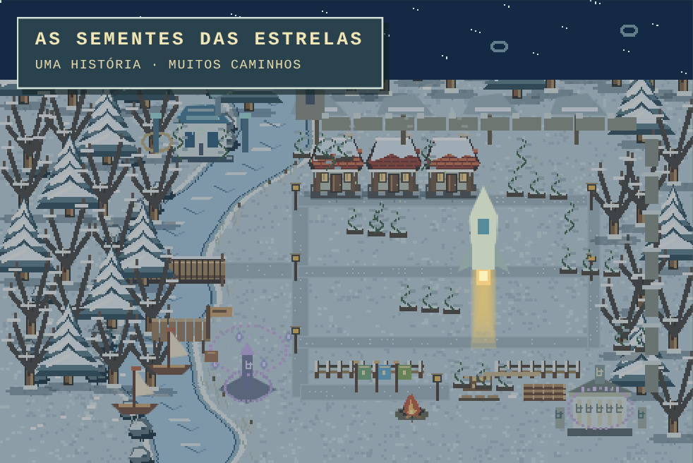
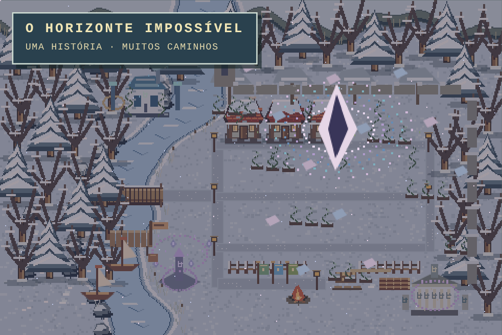

# Destinos e paisagens — 0.2.0

Implementado: nove desfechos, seis influências simultâneas e 19 conselhos com três alternativas cada. Cada decisão tem requisitos de recursos, efeitos imediatos, influências explícitas e registro factual. Não usa IA externa.

## Ciclo de decisão

O primeiro conselho aparece ao final da quarta estação. Resolver uma decisão avança uma estação, junto das políticas agendadas, aplica seus custos uma vez e programa a próxima oferta pelo menos oito estações depois. As ofertas respeitam a idade mínima de cada tema; fome e despedidas têm prioridade quando existem antecedentes reais. Nenhum tema se repete. É possível adiar e continuar a simulação; nenhuma alternativa é escolhida automaticamente. Não são necessariamente apresentados todos os 19 temas na mesma partida.

A interface pausa quando chega um novo conselho. Escolhas inválidas, repetidas, não oferecidas ou sem recursos não alteram influências, não cobram e não entram no registro de comandos. A simulação continua normalmente ao avançar sem uma escolha válida.

As influências vão de 0 a 100: natureza, conhecimento, consciência, ordem, exploração e memória. Ao chegar a 12, surge um projeto; 24 e 48 expandem esse projeto e geram descobertas na crônica. Os efeitos sobre confiança, reservas, energia, floresta e fertilidade ocorrem nas decisões. Os pontos de influência, por si, não dão bônus escondidos de produção.

## Condições dos desfechos

Todos os sete destinos especiais exigem ao menos 112 estações (28 anos) e quatro habitantes vivos. Cada um pode ser escolhido no painel Destinos assim que estiver preparado. O botão informa explicitamente que encerra a história; o comando avança o calendário uma estação e congela o estado sem produzir ou consumir uma estação adicional de recursos.

| Destino                  | Influências                                 | Outras condições                                           | Cenário final                                              |
| ------------------------ | ------------------------------------------- | ---------------------------------------------------------- | ---------------------------------------------------------- |
| O jardim que sonha       | Natureza 48                                 | Fertilidade 65, floresta 55, confiança 50                  | Copas vivas, raízes e sementes luminosas envolvendo a vila |
| As sementes das estrelas | Conhecimento 48, exploração 24              | Madeira 120 e alimento para duas estações                  | Arca em lançamento, trilha de luz, céu estrelado           |
| O coro além dos corpos   | Consciência 48, memória 24                  | Confiança 55                                               | Ecos individuais, pilares de luz e círculo de consciência  |
| A cidade imóvel          | Ordem 48                                    | Todos abrigados, confiança 40, alimento para uma estação   | Malha regular, marcos dourados, símbolo de estabilidade    |
| Povos do horizonte       | Exploração 48                               | Madeira 60 e alimento para uma estação                     | Barcos, caravanas e uma rota para fora do vale             |
| O arquivo das eras       | Memória 48                                  | Madeira 80                                                 | Monólitos inscritos e arquivo iluminado                    |
| O horizonte impossível   | Conhecimento 48, consciência 40, memória 16 | Confiança 55 e saúde média 60                              | Passagem geométrica, fragmentos suspensos e constelações   |
| O legado dos fundadores  | Nenhuma                                     | Vivos ao fim das 160 estações, sem outro destino preparado | Noite de lanternas                                         |
| O último silêncio        | Nenhuma                                     | Nenhum habitante vivo                                      | Ruínas, silêncio e vestígios dos projetos anteriores       |

Os recursos listados são reservas necessárias para tornar o projeto viável no encerramento, não cobranças repetidas. A ausência de alimento ainda pode produzir extinção antes de uma partida estar pronta para migrar.

Na estação 160, extinção tem prioridade. Entre os destinos preparados, o horizonte impossível tem prioridade; depois vale a maior influência de cada caminho. Empates seguem a ordem estável da tabela acima. O jogador pode escolher outro destino elegível antes desse limite. Sem destino extraordinário preparado, o resultado é legado.

A placa antiga encontrada no vale fornece a base ficcional para as descobertas extraordinárias dentro da escala de quarenta anos. Não há uma árvore tecnológica completa nesta versão.

## Cenários combinados

Cada influência é uma camada independente: jardins e corredores vivos; observatório e instrumentos; santuário de consciência; torre e muralhas; porto e barcos; arquivo e inscrições. Ao mudar o rumo, o jogador conserva os projetos já construídos. Natureza e conhecimento incluem vegetação no observatório; consciência e memória incluem ecos no arquivo. As estações continuam alterando o terreno e a vegetação, mesmo em paisagens híbridas.

O final aplica uma transformação adicional sobre essa paisagem acumulada. A crônica reconhece combinações como natureza/conhecimento, consciência/memória, exploração/conhecimento e ordem/natureza. Uma ordem forte sem espaço acumulado para memória, consciência ou natureza produz um epílogo mais ambíguo. Não há nove mapas isolados que apagam as decisões anteriores.

## Dados, validação e limites

Formato JSON 2, regras 0.2.0. Leitura de partidas 0.1.0 com migração explícita: preserva pessoas, recursos, eventos e fim já alcançado, inicia influências em zero e oferece novos conselhos apenas no futuro. Salvamentos terminados não reabrem automaticamente. Nenhum salvamento precisa ser apagado.

`npm test` verifica os sete destinos especiais por partidas completas com escolhas reais, sem injetar recursos ou pontos. Legado e extinção continuam cobertos pelas trajetórias anteriores. `npm run destinies` imprime diagnósticos de sete estratégias gananciosas até o limite; como não seleciona um encerramento antecipado, outra combinação elegível pode prevalecer.

Os testes de navegador verificam conselho, persistência, painel de requisitos, combinações por regiões de pixels e cenas finais distintas. Capturas em `test-results/` são fixtures visuais de verificação, não evidência de equilíbrio. Teste físico em Android continua pendente. As eras existentes continuam sobrevivência/comunidade; os caminhos extraordinários não fingem implementar todas as eras ou tecnologias da visão original.

## Capturas de verificação

Fixtures com influências combinadas para comparar o tratamento de cada final (não são partidas naturais):

## Refinamento visual 0.2.1

A classificação por cor considera o ganho efetivo de cada alternativa. Os bairros agora modificam terreno e casas, crescem entre os marcos e acrescentam monumentos a partir de 72 pontos. Escolhas continuam usando as regras 0.2.0 e o formato 2, sem migração adicional. Consulte [a direção visual](DIRECAO-VISUAL.md) para as seis cores e seus cenários.
