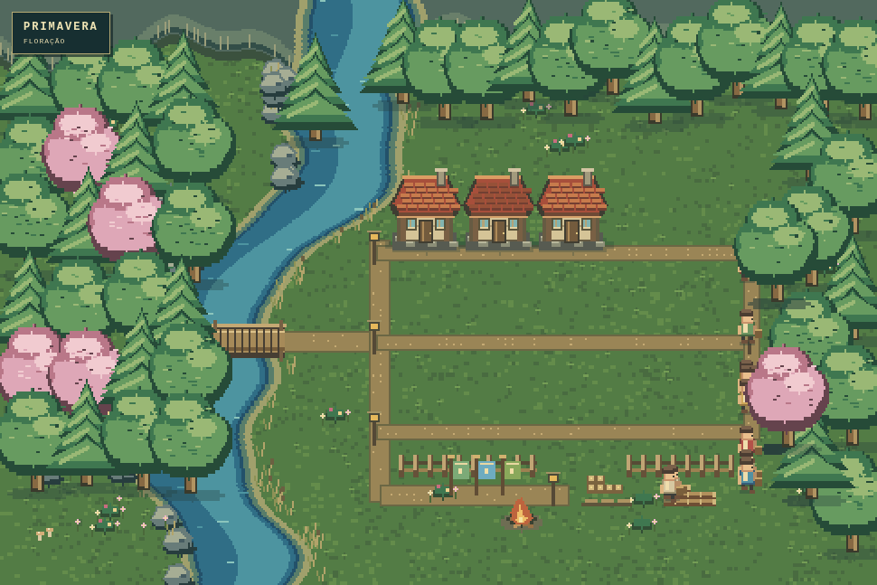
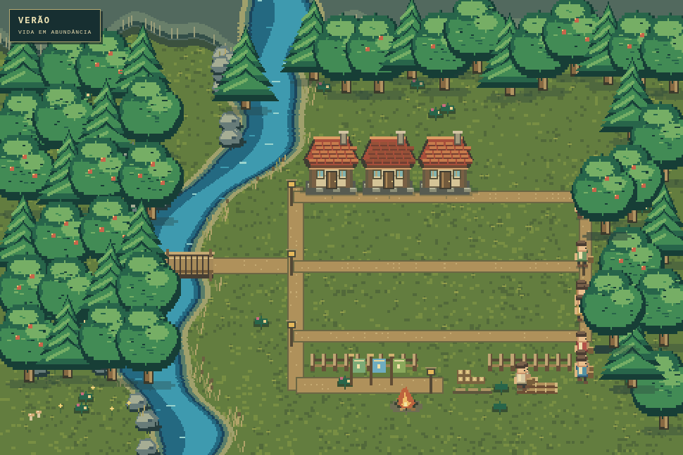
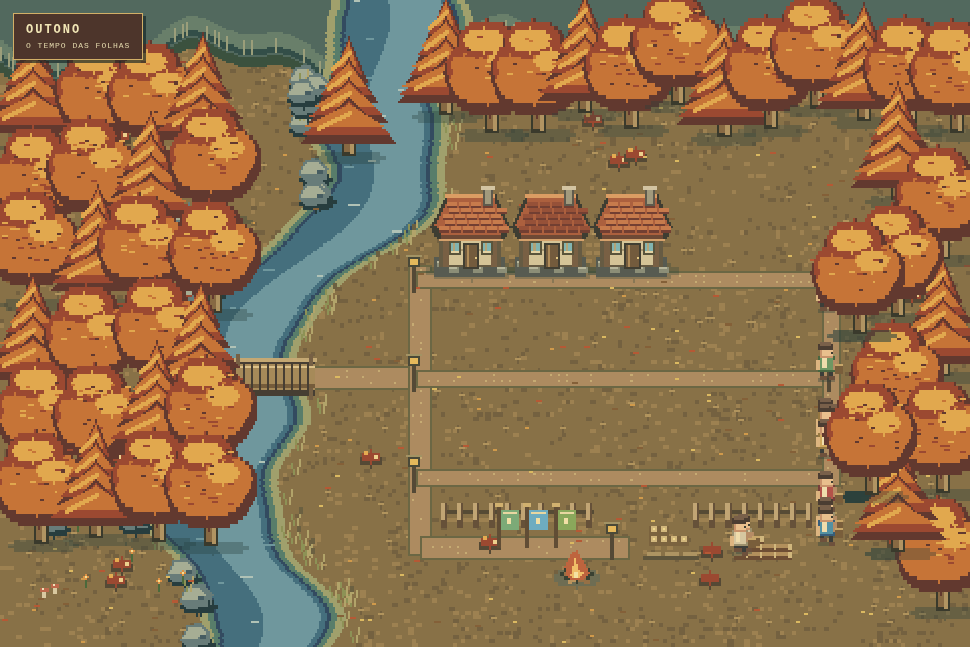
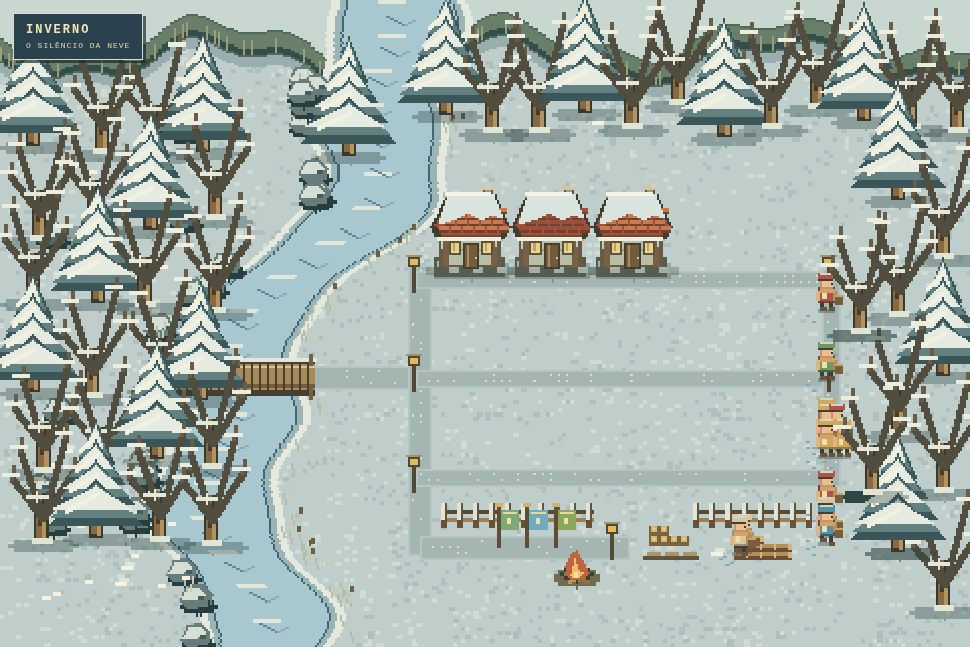
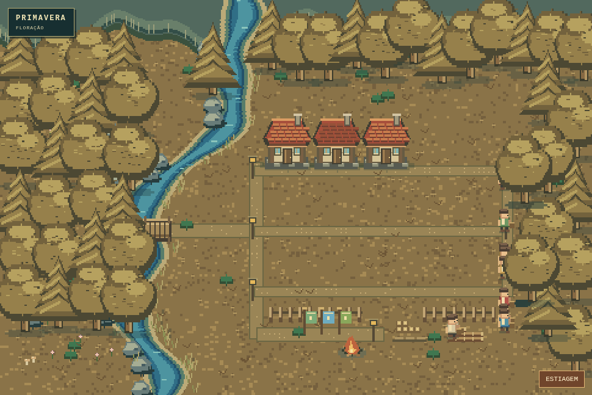
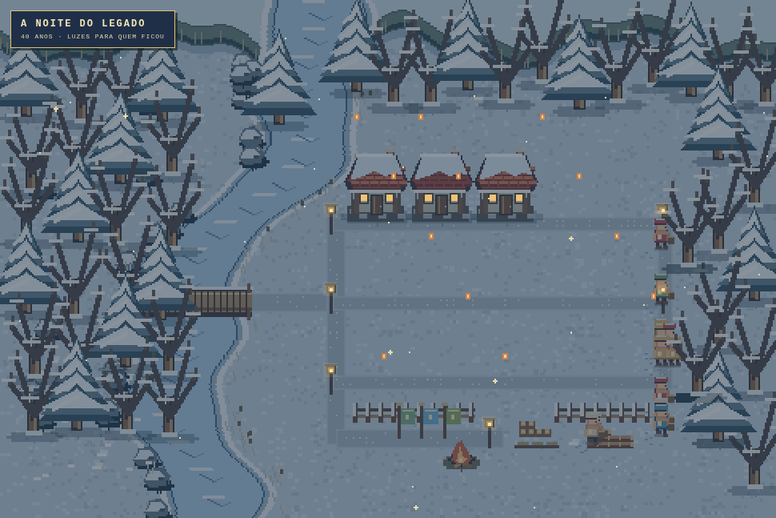
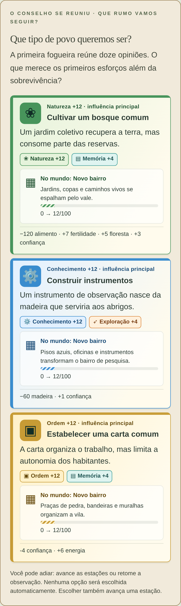
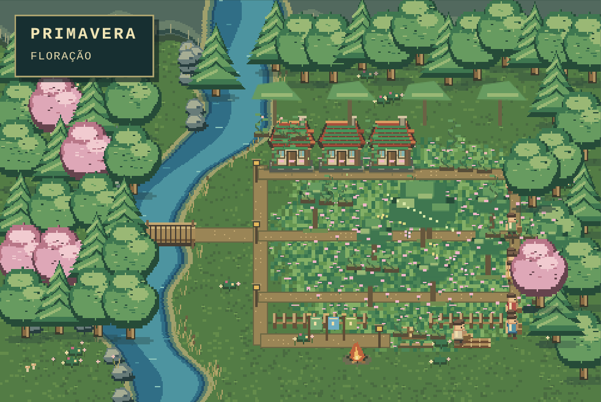
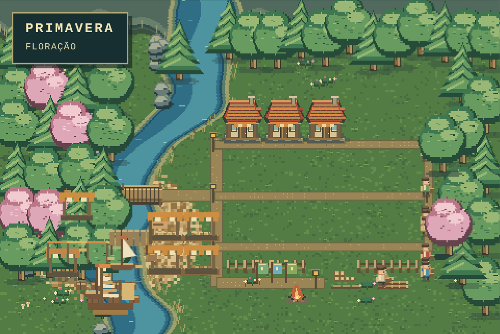
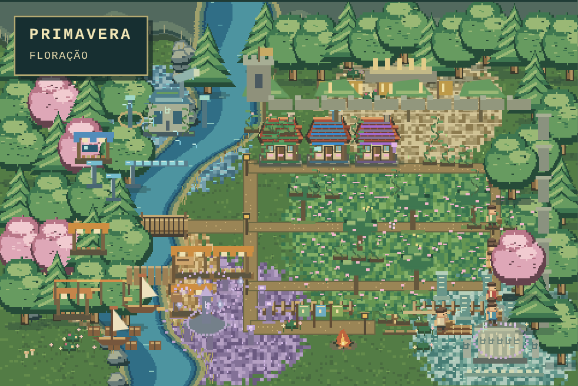

# Direção visual — um mundo em 16 bits

Revisão: 17/10/2026. Pixel art inspirada em RPGs de 16 bits, com resolução lógica de 480 × 320, desenho em pixels inteiros e escala sem suavização. Não há dependência de imagens ou API externa.

## Lugares e acontecimentos — 0.3.0

Observatório, porto e memorial têm pontos de toque próprios. O bosque do jogador mostra marcação, andaimes, mudas e árvores adultas. A luz entre as raízes pode receber instrumentos ou proteção, preservando uma diferença visível após a escolha. Participantes reais trabalham junto ao projeto, visitam lugares em descanso e se reúnem no memorial.

A textura do terreno dos bairros passou a usar manchas maiores e detalhes esparsos, dando destaque a pessoas e construções. [Regras e limitações das interações](INTERACOES.md).

## Escolhas e bairros — 0.2.1

A alternativa assume a cor do maior ganho efetivo, respeitando o teto de 100. Empates exibem duas cores. Nomes e ícones acompanham todas as cores; a leitura não depende de distinguir as tonalidades.

| Influência | Cor | Transformações acumuladas |
| --- | --- | --- |
| Natureza | Verde | Jardins, bosques, flores, raízes e grande árvore |
| Conhecimento | Azul | Pisos com circuitos, oficinas, instrumentos e torre de energia |
| Consciência | Violeta | Cristais, círculos, lanternas e arco de ressonância |
| Ordem | Dourado | Praça de pedra, estandartes, muralhas e cidadela |
| Exploração | Laranja | Porto, passarelas, mercados, cargas e grande embarcação |
| Memória | Turquesa | Mosaicos, inscrições, memoriais e obelisco |

Desde o primeiro ponto, uma área começa a mudar. A extensão cresce continuamente; 12 pontos estabelecem o bairro, 24 expandem seus elementos, 48 desenvolvem os projetos e 72 acrescentam monumentos. As casas adotam os estilos acumulados. As estações continuam alterando solo, vegetação e neve; as novas camadas não substituem o mapa por uma imagem fixa.

Cada decisão resolvida também deixa um marco colorido permanente. O resultado aparece acima do mundo com os pontos atuais; um realce temporário indica o bairro afetado, respeitando a opção de movimento reduzido. Borboletas, fluxos de energia, ecos, bandeiras, cargas e inscrições animadas dão atividade aos caminhos em desenvolvimento.

As construções de distrito representam escolhas e cultura. Não criam uma economia de comércio ou uma árvore de pesquisa adicionais. A renderização não consome o gerador aleatório da simulação, não modifica recursos nem muda o formato do salvamento.

A comparação automatizada mede pixels em mapas com a mesma estação e a mesma semente: primeira influência, novo investimento entre marcos, paisagem avançada e combinações. Artefatos gerados em `test-results/`; capturas selecionadas abaixo são cenários de verificação, não partidas naturais.

## As quatro estações

| Primavera | Verão |
| --- | --- |
|  |  |
| Florações rosadas, flores no chão, água alta e chuva leve | Árvores densas, frutos, insetos e margens mais expostas |

| Outono | Inverno |
| --- | --- |
|  |  |
| Copas em cobre/dourado, folhas no chão e no ar | Neve no solo e telhados, gelo no rio, galhos nus, fumaça e roupas quentes |

## Acontecimentos precisam deixar vestígios

| Acontecimento ou condição real | Mudança no mundo |
| --- | --- |
| Fundação | Praça, fogueira e estandartes iniciais |
| Políticas | Três estandartes mudam conforme trabalho, distribuição e extração |
| Escassez/fome | Cestos vazios, fogueira menor, postura e sinal dos habitantes |
| Recuperação alimentar | Provisões voltam aos cestos e refeição compartilhada temporária |
| Estiagem/fertilidade baixa | Rio recua, solo racha, vegetação seca e poeira atravessa o cenário |
| Doença | Faixas de cuidado nas casas e sinais nos habitantes afetados |
| Nascimento | Fitas e uma manta temporária; a criança real aparece na população |
| Morte | Pedra no memorial, até o limite visual de 24; habitante deixa de circular |
| Construção | Andaime, paredes e telhado correspondem ao progresso do abrigo real |
| Reparo | Remendos e telhas novas no abrigo indicado pelo evento |
| Mutirão | Estandarte, ferramentas e faíscas dos construtores |
| Tradição de reservas | Proteção de provisões permanece junto à praça |
| Tradição de abrigo | Beirais e apoios reforçados permanecem nas casas |
| Comunidade/regressão | Caminhos de pedra e detalhes da praça acompanham a era |
| Extração | Floresta retirada deixa tocos; pilhas de madeira refletem o estoque |
| Legado | Noite azul, janelas acesas, lanternas e céu estrelado sobre a vila |
| Extinção | Casas arruinadas, vegetação sobre as estruturas, fogueira apagada e neblina |

Efeitos recentes duram até três estações visuais; provisões, vegetação, construções, tradições, memorial e finais são derivados do estado persistido. Não criar eventos de jogo para justificar um efeito bonito. Efeitos extraordinários futuros precisam de nova representação e verificação no mesmo pacote de implementação.

## Implementação

- appearance.ts traduz estado e acontecimentos em sinais, com registro tipado de todos os tipos de evento existentes.
- pixelWorld.ts desenha terreno, sprites, casas, provisões, habitantes, clima e efeitos. Camadas estáticas e sprites são cacheados por estado.
- World.tsx escala a superfície, aplica seleção e oferece zoom com exploração por rolagem. A animação usa 30 quadros por segundo; reduzir movimentos congela efeitos decorativos sem esconder o estado.
- A textura usa hash da semente, separado do PRNG da simulação. A mudança visual não modifica regras, semente, salvamento ou resultados das partidas existentes.

## Verificação

27 testes Vitest passaram. A suíte completa de navegador existente mais os cenários sazonais e de eventos passou em 24 casos; outros dois casos de zoom passaram separadamente, totalizando 26. Os cenários visuais comparam pixels do Canvas (não apenas rótulos), incluindo todas as quatro estações e 13 categorias de mudança após a fundação. A análise Axe continuou sem violações nos quatro painéis. Cenário de 60 habitantes continuou em 30 quadros/s no ambiente emulado.

As capturas usam fixtures explícitas para isolar aparência; não afirmam que finais extraordinários futuros já existem. Android físico ainda não foi medido.

## Capturas dos bairros

Cenários de verificação com a mesma estação e pontuações preparadas para inspeção visual.

