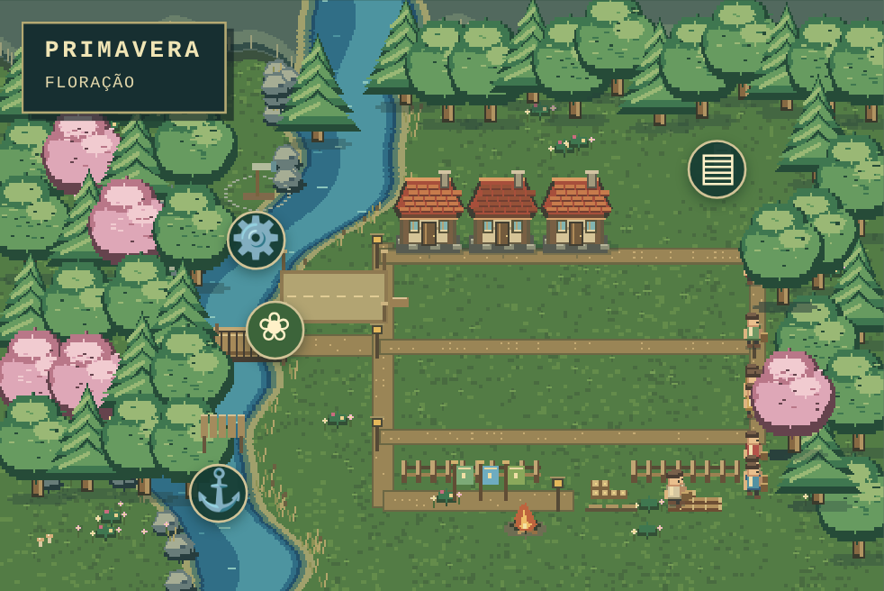
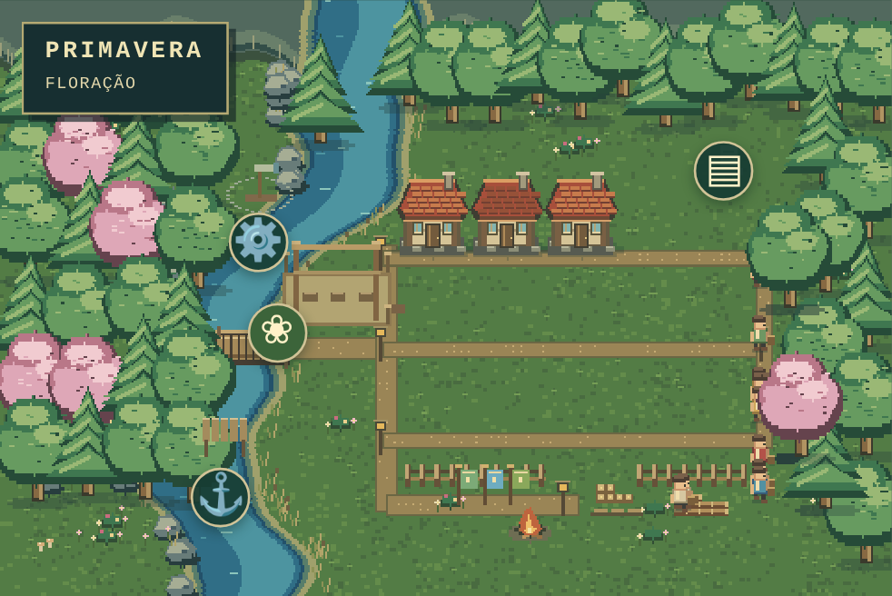
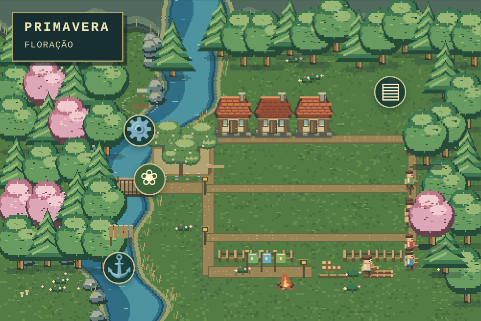
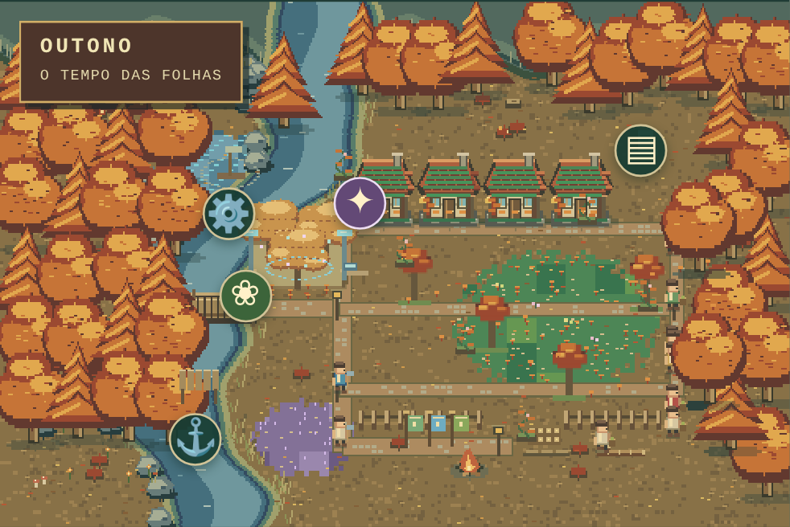

# Lugares, bosque e descoberta — regras 0.3.0

Marco implementado a partir da pesquisa visual: três lugares interativos, uma obra em etapas e uma descoberta investigável. O mapa usa pontos de toque com nomes e ícones; os cartões também funcionam por teclado. Abrir um lugar pausa a observação automática.

## Os lugares

| Lugar | Interação real |
| --- | --- |
| Observatório | Conhecimento atual, descobertas da crônica, planejamento e acompanhamento do bosque; acesso ao fenômeno depois de aparecer |
| Porto | Uma viagem de troca por comunidade: 120 de alimento; retorno após duas estações com 90 de madeira e exploração +6 |
| Memorial | Fundação e despedidas registradas; celebração única após quatro estações por 60 de alimento, confiança +6 e memória +6 |

As ações avançam uma estação. Custos só são cobrados quando o comando é aceito. Ações repetidas, inválidas, sem recursos ou após o desfecho são rejeitadas. A interface permite acompanhar as próximas estações dentro do cartão.

## Bosque experimental

Uma obra por comunidade; reserva inicial de 80 de madeira e 120 de alimento. Início permitido até a estação 153. O jogador escolhe um local no mapa ou no cartão:

| Local | Recompensas na inauguração |
| --- | --- |
| Margem do rio | Natureza +12, fertilidade +10, floresta +12, confiança +2 |
| Perto das casas | Natureza +12, fertilidade +5, floresta +8, confiança +7 |

Há quatro estados persistidos: terreno marcado (0), preparação/andaimes (1), mudas plantadas (2) e bosque inaugurado (3). Não avança na estação em que é iniciado. Em cada estação posterior, avança no máximo uma etapa se, após as necessidades básicas, existir alimento para mais uma estação e ao menos um adulto com idade a partir de 16 anos, saúde >= 50, energia >= 30 e fome < 40.

Até dois participantes ajudam depois das tarefas básicas. Seus IDs são registrados; cada um gasta 4 de energia por etapa. A contribuição é secundária e não duplica a produção de suas tarefas principais. Os participantes aparecem junto à obra e continuam sendo pessoas reais da simulação. A falta de condições pausa a obra, sem cobranças repetidas. Um desfecho pode deixá-la inacabada.

A inauguração concede recompensas uma vez, respeitando os tetos de 100. Cada etapa tem aparência própria e evento na crônica.

## A luz entre as raízes

O fenômeno aparece quando o bosque está concluído e já passaram quatro estações desde o início da obra, portanto após a inauguração no percurso mais rápido. Um sinal no mapa permite abrir o relato e decidir:

| Escolha | Custo | Consequência |
| --- | --- | --- |
| Investigar com instrumentos | 60 alimento, 25 madeira | Conhecimento +8, consciência +4, floresta −3; instrumentos permanecem entre as árvores |
| Preservar as raízes luminosas | 80 alimento | Natureza +6, memória +6, floresta +3, confiança +3; lanternas e proteção permanecem no bosque |

A decisão é única e permanece no JSON e na crônica. Sem investigação, o sinal fica disponível até o desfecho. Não há chamada a IA externa, sorteio adicional ou revelação antecipada por contador de influência.

## Arte e implementação

O solo dos bairros usa manchas coerentes e detalhes esparsos, reduzindo a disputa visual com construções e pessoas. Os pontos de toque são compactos; a área de interação tem ao menos 44 pixels CSS. A seleção do local destaca alternativas sem cobrar recursos até o comando de início.

Adultos em descanso podem visitar o observatório e o memorial quando as influências correspondentes existem. Participantes da celebração aparecem no memorial, e o barco da viagem é visível enquanto há uma troca em andamento. As visitas usam habitantes reais e preservam os cálculos de produção. Movimento reduzido congela efeitos decorativos.

A simulação está em `src/simulation/world.ts`; os desenhos em `src/rendering/interactiveWorld.ts`; os cartões em `src/WorldPlaces.tsx`. As camadas visuais não consomem o PRNG do jogo.

Formato JSON 3, regras 0.3.0. Importações 0.1.0 e 0.2.0 migram preservando habitantes, recursos, influências, decisões, crônica e desfechos, com o novo mundo interativo inicialmente sem obras ou ações realizadas. Partidas encerradas continuam encerradas. A cópia anterior de salvamento também pode ser migrada.

## Referências de direção

- [Stardew Valley](https://www.stardewvalley.net/media/): identidade dos lugares e objetos legíveis.
- [Kingdom Two Crowns](https://kingdomthegame.com/kingdom-two-crowns/): atividade e atmosfera com poucos elementos de interface.
- [WorldBox](https://www.superworldbox.com/): observação e inspeção do mundo.
- [Terra Nil](https://store.steampowered.com/app/1593030/Terra_Nil/): transformação ambiental em etapas.
- [Dorfromantik](https://www.toukana.com/dorfromantik/presskit): composição e agrupamentos de paisagem.
- [dotAGE](https://www.michelepirovano.com/dotage/presskit/): pressões de sobrevivência e consequências por turno.

As aplicações são decisões de design do projeto. Não usamos imagens, sprites ou código desses jogos.

## Capturas de verificação

As quatro etapas abaixo usam a mesma estação e semente, em fixtures preparadas para comparação visual.

| Marcação | Preparação |
| --- | --- |
|  |  |

| Mudas | Inauguração |
| --- | --- |
|  |  |

A captura abaixo vem do fluxo de jogo por toque até investigar o bosque:

